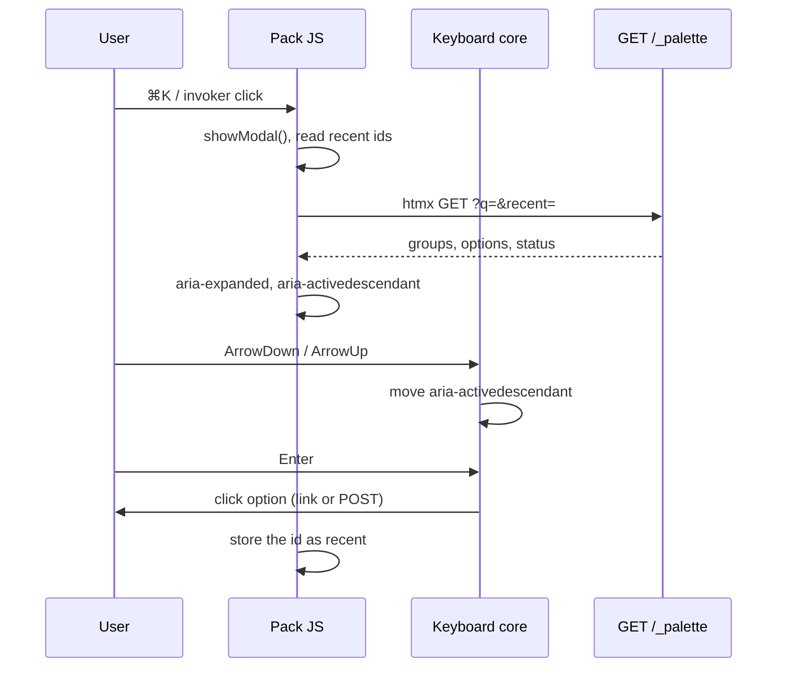

# autumn-command-palette-plugin

A ⌘K command palette for [Autumn](https://github.com/autumn-foundation/autumn)
apps (autumn#3416). It is a widget pack. It uses the widget plugin seam
(autumn ADR 0030).

- ⌘K or Ctrl+K opens it. You can set a different hotkey. An invoker button
  also opens it.
- The server finds the commands. htmx sends the query and shows the
  results: groups, `kbd` shortcuts and recent items.
- The app fills a command registry: routes, actions and (with the `admin`
  feature) the admin plugin resources.
- With JavaScript off, the invoker is a link to a plain search page.

## Install

```toml
[dependencies]
autumn-command-palette-plugin = "0.1"
```

```rust
use autumn_command_palette_plugin::{Command, CommandPalette, CommandRegistry};

let palette = CommandPalette::new(
    CommandRegistry::new()
        .add(Command::route("home", "Dashboard", "/").shortcut(&["G", "D"]))
        .add(Command::route("posts", "Posts", "/posts").keywords(["articles"]))
        .add(Command::action("posts.new", "New post", "/posts").hint("Write a draft")),
);

autumn_web::app()
    .plugin(palette.clone())
    // ...
    ;
```

Put the palette in the layout. Link the pack assets after the core assets:

```rust
html! {
    head {
        link rel="stylesheet" href=(autumn_web::ui::WIDGETS_CSS_PATH);
        script src="/static/js/htmx.min.js" defer {}
        script src="/static/js/autumn-widgets.js" defer {}
        (autumn_command_palette_plugin::pack().head())
    }
    body {
        header { (palette) }
        // ...
    }
}
```

`(palette)` writes the invoker and the `<dialog>`. Install one palette for
each app.

## Commands

| Constructor | Result |
|---|---|
| `Command::route(id, title, href)` | `<a role="option" href>`. Group: `Go to`. |
| `Command::action(id, title, path)` | A `POST` to `path` with the CSRF token. Group: `Actions`. |

Builder methods: `group`, `keywords`, `shortcut`, `hint`, `visible_when`.

An id has 1 to 100 ASCII letters, digits and `- _ . : /`.
`CommandRegistry::add` panics on a bad or duplicate id. `try_add` returns
the error.

`visible_when(|parts| ...)` runs for each request. Use it to hide a command
from a user. The filter also removes the command from the recent items.

### Admin resources

Turn on the `admin` feature:

```rust
use autumn_command_palette_plugin::admin::admin_commands;

let commands = admin_commands("/admin", &[&ProjectAdmin], |parts| is_admin(parts));
let registry = CommandRegistry::new().extend(commands);
```

Each model gives `{plural}` (`/admin/{slug}`) and `New {name}`
(`/admin/{slug}/new`). The filter is not optional: the palette does not know
the admin role. To show the commands to all users, give `|_| true`.

## Settings

| Method | Default |
|---|---|
| `id("cmdk")` | `command-palette`. Other ids start with it. |
| `hotkey(Hotkey::parse("ctrl+shift+p")?)` | `mod+k` (Ctrl+K or ⌘K) |
| `labels(labels)` | English texts. Change the fields of `Labels::default()`. |
| `limits(Limits { results, recent })` | 20 results, 5 recent items |
| `page_layout(\|title, body\| ...)` | A plain page |

A hotkey spec has modifiers and one key, joined by `+`. The modifiers are
`mod` (Ctrl or ⌘), `ctrl`, `meta`, `alt` and `shift`. The key is one visible
ASCII character or `F1` to `F12`. A key with no modifier (for example `/`)
does nothing while focus is in a text field.

## How it works



- The dialog is the core `modal()`. Escape and a backdrop click close it.
  Focus goes back to the element that had it.
- The input is an APG combobox. Focus stays on it. The listbox uses
  `data-autumn-activedescendant`. The pack JS has no arrow-key code.
- `GET /_palette` sends the listbox content to an htmx request. It sends
  the search page to other requests. The answer is `private, no-store`.
- Recent ids are in `localStorage`. The server shows only ids that are in
  the registry and pass `visible_when`.

## Accessibility and CSP

- The pack passes `run_widget_conformance` and
  `run_widget_browser_conformance` (axe in both schemes, console, keyboard).
- `tests/browser.rs` checks the combobox in the dialog with real keys.
- No inline script or style. The default CSP `script-src 'self'` works.

## Tests

| Command | Runs |
|---|---|
| `cargo test` | unit, property, integration and doc tests |
| `cargo test --features admin` | also the admin commands |
| `cargo test --features system-tests --test browser -- --include-ignored` | Chromium |
| `verus verification/palette.rs` | the Verus model of ranking and recent ids |

The browser tests need Chromium. Set `AUTUMN_CHROMIUM` to its path, or put
`chromium` or `google-chrome` on `PATH`.

## License

Apache-2.0. `tests/fixtures/axe-core` is axe-core 4.x under MPL-2.0.
