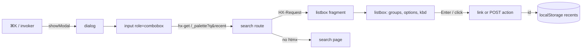

# Plan: command palette plugin (autumn#3416)

## Goal

Ship `autumn-command-palette-plugin`. It is a ⌘K command palette for
Autumn apps. It uses the widget plugin seam (ADR 0030 in autumn).

## Acceptance criteria (from the issue)

1. Open with ⌘K/Ctrl+K, a configurable hotkey, or an invoker button.
2. The server sends the results through htmx. Results have groups,
   shortcuts in `kbd`, and recent items.
3. The app fills a command registry: routes, actions, and (optional)
   admin plugin resources.
4. No-JS fallback: a plain search page.
5. Browser keyboard tests (APG combobox in a dialog) and axe, through
   plugin conformance.
6. A story, registered through the seam.

## Brainstorm

- Use the core `modal()` `<dialog>`. It gives the focus trap, Escape and
  focus return.
- Use the keyboard core `data-autumn-activedescendant` on the listbox. The
  pack JS has no arrow-key code.
- One route serves two answers. An htmx request gets the listbox fragment.
  Other requests get the full search page.
- A link command is `<a role="option" href>`. An action command is a
  `<button role="option" formmethod="post">` with the CSRF token.
- Recent items are in `localStorage`. The JS sends their ids. The server
  shows only ids that are in the registry.
- The hotkey is a small spec string: `mod+k`, `ctrl+shift+p`, `/`.
- The admin feature turns each `AdminModel` into two commands: the list
  and "New".

## Reverse brainstorm (how to make it fail)

| Way to fail | Prevention |
|---|---|
| Show admin links to all users. | `Command::visible_when` filters each request. The admin helper docs say to use it. |
| Run a POST action without CSRF. | Action options submit a form that holds the request CSRF token. |
| Show a recent id that the app removed. | The server resolves ids against the registry. It drops unknown ids. |
| XSS through a title. | maud escapes all text. A test sends `<script>` in a title. |
| A long query or many recent ids use CPU. | Cut the query to 200 chars and the recent ids to 20. |
| ⌘K types `k` in a text field. | `/`-type hotkeys (no modifier) do nothing in an editable field. |
| Keyboard user is stuck in the dialog. | Native `<dialog>`: Escape closes it. Focus goes back. A test proves it. |
| JS off: the invoker does nothing. | The invoker is a link to the search page. JS shows a button instead. |
| Stale `aria-activedescendant` after a swap. | The server selects the first option. The JS sets `aria-activedescendant` to it after each swap. |
| Two commands with one id. | `CommandRegistry::add` panics at start-up, as duplicate story slugs do. |

## Six thinking hats

- **White (facts).** autumn-web 0.10 has `WidgetPack`, `modal()`,
  `kbd_combo`, the keyboard core and `run_widget_*_conformance`.
  `Page::press` sends no modifier keys. `SystemTest` takes only `Route`s,
  so the search route is a `#[get]` route with a fixed path.
- **Red (feelings).** Users expect ⌘K to open the palette at once. They
  expect a clean design.
  The first result must be active, so Enter runs it at once.
- **Black (risks).** `/_palette` can be the same path as an app route.
  One palette for each app. The tests send synthetic key events for ⌘K.
  CI runs the Verus model.
- **Yellow (benefits).** No new JS framework. No keyboard code. Same
  axe gate as core. Works with JS off.
- **Green (ideas).** Later: fuzzy scoring, server-side recents per user,
  async command sources.
- **Blue (process).** SPEC (Verus model of ranking and recents) → RED
  tests → GREEN code → REFACTOR → agent review → AC evidence.

## Design

## Test plan

| Layer | Tests |
|---|---|
| Unit | hotkey parse, registry, ranking, recents, render, escape |
| Property | ranking is bounded, unique and matching; recents bounded and unique |
| Integration (`TestApp`) | route fragment, page, CSRF, visibility, plugin mount |
| Static conformance | `run_widget_conformance(&pack())` |
| Browser (Chromium) | conformance (axe, console, keyboard); ⌘K, Ctrl+K, custom hotkey, invoker; arrows, Enter, Escape, focus return; recents; action POST; axe on the open dialog; JS off |
| Verus | `verification/palette.rs`: ranking take and recents push |
